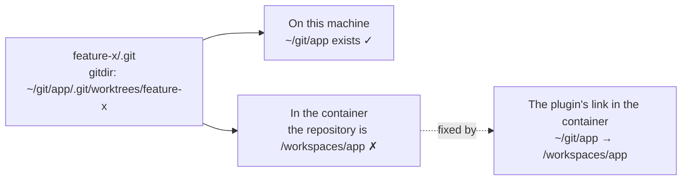
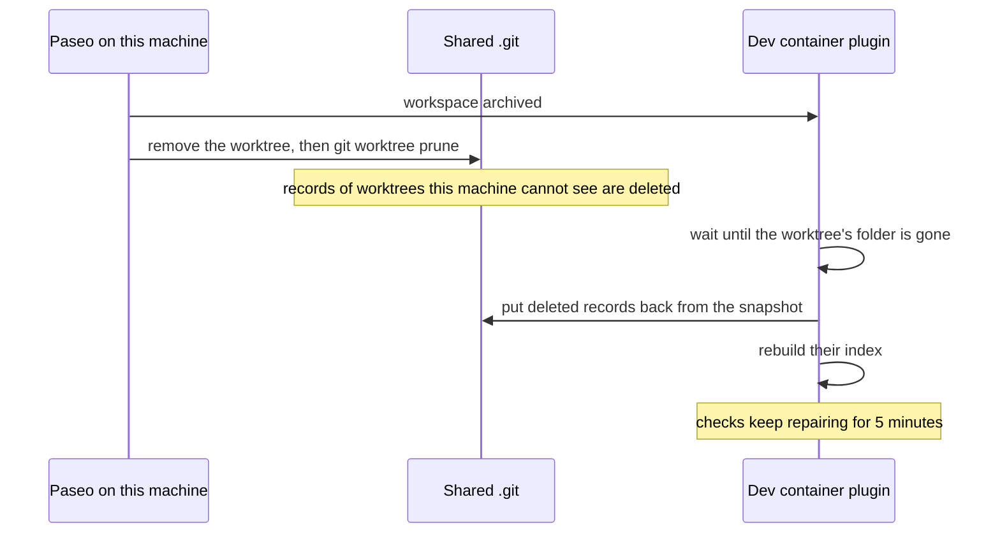
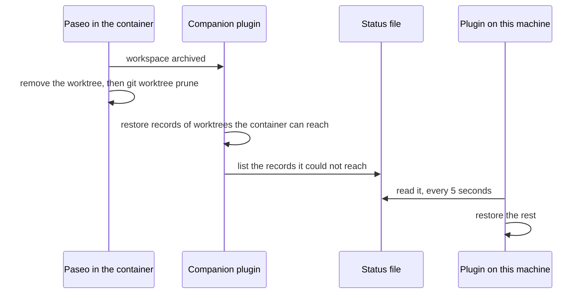
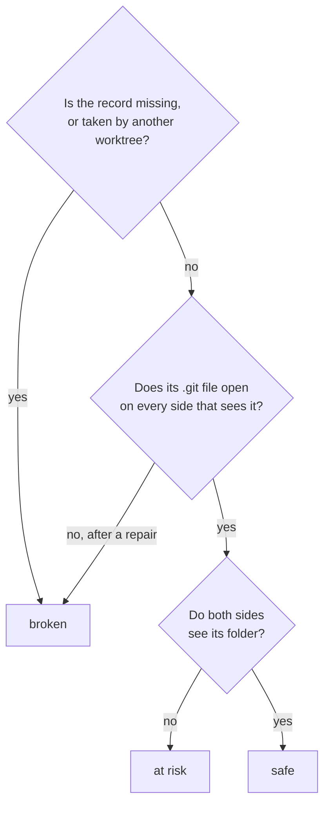

# Worktrees shared with a dev container

> [!NOTE]
> This applies when Paseo uses a repository on this machine **and** in its dev container. Both sides then share one `.git`.

## At a glance

- **What breaks:** archiving a workspace, `git worktree prune`, or `git worktree repair` on one side can break the other side's worktrees.
- **What the plugin does:** it snapshots worktree records, repairs after archives on either side, and flags anything else on the container's row.
- **What you do:** when a row shows **broken**, open its card and press **Restore**.

## Why it breaks

Git links each worktree to a record in `.git/worktrees/<name>` by absolute path, and the repository has a different path on each side.



| On one side | What it does to the other side | What the plugin does |
| --- | --- | --- |
| Archive a workspace | Paseo runs `git worktree prune`, which deletes the records of worktrees this side cannot see | Restores them on its own |
| `git worktree prune` | Same | Flags them **broken**: press Restore |
| `git worktree repair` | Rewrites every worktree's `.git` file to this side's repository path | On this machine: covered by the link. In the container: flagged **broken**, press Restore |

## Archive on this machine



The archived worktree stays gone: a record only comes back when its folder still exists and that folder's `.git` file names it.

## Archive in the container



## What the row shows



| Status | Meaning | What to do |
| --- | --- | --- |
| safe | Both sides see it, and git opens it | Nothing |
| at risk | Only one side sees its folder, so a prune on the other side deletes its record. Often a worktree made by hand outside Paseo's folders | Nothing: it is restored after archives |
| broken | Its record is gone or taken, or its `.git` file points where a side cannot open it | Press **Restore** |
| restored | Repaired in the last day | Nothing |

> [!NOTE]
> **Restore never touches your files.** It puts the record back and rebuilds the index from `HEAD`. Staged changes show as unstaged afterwards, a merge or rebase in progress is lost, and a detached `HEAD` returns to its last snapshot.

> [!WARNING]
> **Repaired only when you press Restore:**
> - `git worktree prune` or `repair` run by hand, by an agent, or by a tool such as GitKraken, on either side
> - damage while this machine's Paseo daemon is stopped
>
> **Not covered:**
> - records deleted before the plugin's first snapshot: recover them by hand, below
> - containers without the plugin's Paseo home, such as ones created before it, or whose config sets `PASEO_HOME`: rebuild them from Paseo

## Under the hood

| Piece | What it does | When |
| --- | --- | --- |
| Same-path mounts | The container's Paseo home and this machine's Paseo worktrees have the same path on both sides, so a prune keeps their records | When the container is created |
| Repository link | In the container, as root, links this machine's repository path to its folder there | Every daemon start and check; lost on rebuild |
| Snapshots | Copies working records to `<container home>/devcontainer-guard/snapshots`, kept until both sides confirm the folder is gone | Every check |
| Checks | Sorts worktrees into safe, at risk, and broken | Every 15 seconds while the app is open, every minute otherwise |
| Companion plugin | `devcontainer-companion`, in the container's Paseo daemon, repairs after archives there | Installed before the daemon starts |
| Warning | Shown once when you create a workspace here for a repository that also runs in a container | Workspace creation |

> [!NOTE]
> - The companion plugin needs Paseo 0.15 or later in the container. Installing it sets `pluginsEnabled` in that daemon's config, which also starts any other plugin configured there, and skips the trust prompt. If you disable it with `paseo plugin disable devcontainer-companion`, it stays disabled, and so does its plugin mirroring. Containers that ran the earlier `devcontainer-guard` companion switch to it the next time their daemon is stopped and started from Paseo.
> - With Docker Desktop, the container can see this machine's changes to `.git` late. If git fails in the container right after a change here, try again a few seconds later.
> - Turn the guard off with **Guard shared worktrees** under **Shared worktrees** in the plugin's settings.

## Recover by hand

Run these on the side where you use the worktree. Snapshots are under the "Paseo homes folder" setting, `~/.paseo/plugin-data/devcontainer-host/homes` by default.

1. Find the record's name, the last part of the `.git` file:

   ```bash
   cat .git   # gitdir: /Users/you/git/app/.git/worktrees/feature-x
   ```

2. If it points at the other side's path, point it at this side's:

   ```bash
   echo "gitdir: $HOME/git/app/.git/worktrees/feature-x" > .git
   ```

3. If the record is missing, copy it back from the snapshot:

   ```bash
   SNAPSHOT=~/.paseo/plugin-data/devcontainer-host/homes/app/devcontainer-guard/snapshots/feature-x
   mkdir ~/git/app/.git/worktrees/feature-x
   cp "$SNAPSHOT"/HEAD "$SNAPSHOT"/commondir "$SNAPSHOT"/gitdir ~/git/app/.git/worktrees/feature-x/
   ```

   Without a snapshot, create the three files: `gitdir` holds the worktree's `.git` path, `commondir` holds `../..`, and `HEAD` holds `ref: refs/heads/<branch>`.

4. Rebuild the index without touching files, then check:

   ```bash
   git reset && git status
   ```
